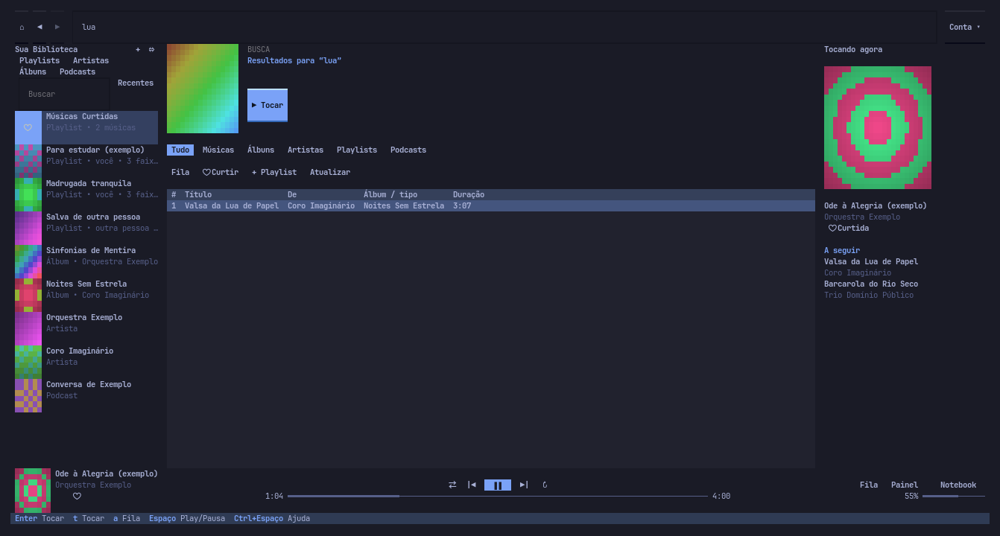
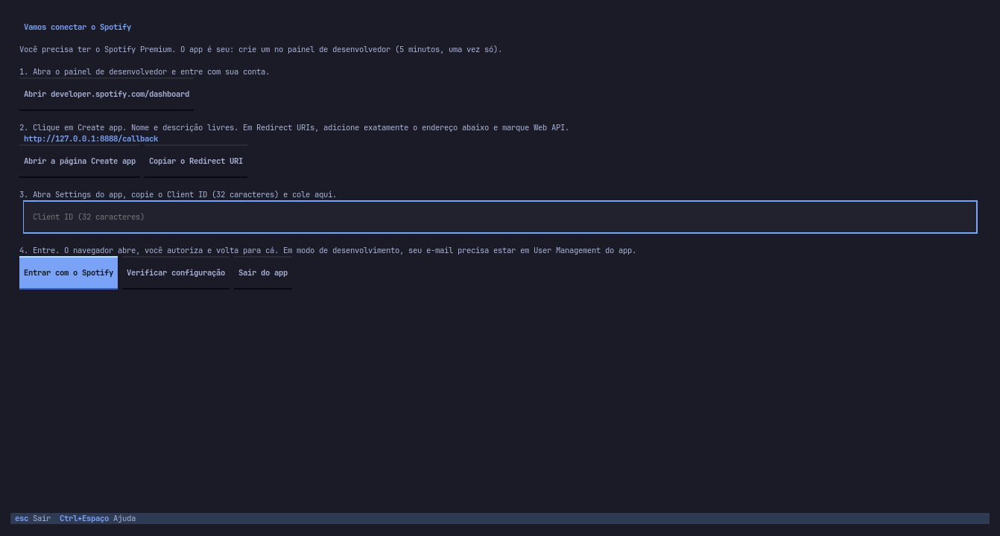

# oma-spotify

TUI em Python (Textual) para ouvir e organizar o Spotify pelo terminal, com a mesma disposição do Spotify Web (biblioteca à esquerda, conteúdo no centro, "Tocando agora" à direita, player embaixo), capas de álbum desenhadas no terminal, mouse e teclado, em português do Brasil e nas cores do tema ativo do Omarchy. Fala com a Web API oficial e exige conta Premium.

Versão 0.2.0.

## Capturas de tela


Abertura: aparece na primeira vez de cada boot e passa com qualquer tecla, clique ou depois de 1,5 s.


Início: biblioteca à esquerda, centro com acesso rápido e carrosséis de capas, painel Tocando agora à direita e o player embaixo.


Página de playlist: capa, botão tocar, salvar e a lista de faixas com colunas.



Busca: digitada na barra superior, com chips por tipo.


Dispositivos: transferir a reprodução ou abrir o Spotify do PC.


Terminal de 80x24: a biblioteca recolhe para as miniaturas e o painel direito some (renderizado pelo próprio Textual, por isso a moldura da janela).



Primeira execução, sem Client ID: passo a passo para criar o app no painel do Spotify. As capturas usam `--demo`, com dados e capas fictícios.

## Recursos

- **Uma tela só, sem abas:** barra superior (início, voltar e avançar do histórico, busca, menu da conta), coluna "Sua Biblioteca" (chips Playlists, Artistas, Álbuns e Podcasts, filtro, ordenação, Músicas Curtidas fixa no topo), centro (Início, playlist, álbum, artista, busca, curtidas, fila, recentes, mais ouvidos, dispositivos e configurações), painel "Tocando agora" com a fila e o player sempre visível.
- **Capas** de álbum, playlist e artista em meio-blocos (▀ com cor de 24 bits) pelo Pillow, com cache em `~/.cache/oma-spotify` (limite de 50 MB). Sem Pillow ou sem rede, aparece um quadrado com as iniciais.
- **Responsivo:** painel direito some abaixo de 120 colunas, a biblioteca recolhe sozinha abaixo de 100. Funciona em 80x24 e fica confortável em 170x45.
- **Reprodução:** play/pausa, próxima, anterior, buscar posição, volume, aleatório, repetir (desligado, lista, faixa), tocar faixa, álbum, playlist ou artista, fila e curtir.
- **Playlists:** criar, adicionar faixa, remover faixa (com confirmação), só nas suas.
- Sem dispositivo ativo (o 404 do Spotify), o app explica em português e oferece "Abrir o Spotify do PC" (roda `spotify` e espera ele aparecer) ou "Escolher dispositivo".
- Erros da API em linguagem clara, sem stack trace. Em 429 o app espera o `Retry-After` e tenta de novo.
- Tudo funciona por mouse e por teclado: toda tecla tem botão equivalente, a roda do mouse rola as listas.
- Modo `--demo`: dados fictícios e capas procedurais, sem login e sem rede.

## Criar o app no painel de desenvolvedor e entrar

O Spotify não deixa um app usar a API sem um app registrado por você. É uma vez só, uns 5 minutos. A tela de configuração guiada do `oma-spotify` mostra os mesmos passos, cada um com botão.

1. Abra <https://developer.spotify.com/dashboard> e entre com a sua conta.
2. Create app. Nome e descrição livres. Em Redirect URIs, adicione exatamente `http://127.0.0.1:8888/callback` (o app mostra o endereço certo, com a porta que você escolheu). Marque Web API.
3. Em Settings do app, copie o Client ID.
4. Em User Management, confira se o e-mail da sua conta está na lista (modo de desenvolvimento).
5. No `oma-spotify`, cole o Client ID (32 caracteres, números e letras de a a f) e use "Entrar com o Spotify". O navegador abre, você autoriza e volta.

Enquanto espera, a tela mostra a contagem regressiva e os botões "Copiar link de login", "Abrir o navegador de novo", "Copiar o Redirect URI", "Cancelar a espera" (fecha a porta na hora) e "Deu erro na página do Spotify?". "Verificar configuração" (também nas Configurações) mostra o início e o fim do Client ID, o Redirect URI enviado, se a porta está livre e se há conexão com accounts.spotify.com, sem chamada autenticada. Teclas na tela de espera: `c` copiar link, `a` abrir de novo, `u` copiar Redirect URI, `x` ou Esc cancelar, `e` erros comuns, `v` verificar.

### Erros comuns no login

| O que aparece | Causa e solução |
|---|---|
| `redirect_uri: Not matching configuration` ou INVALID_CLIENT | O Redirect URI do painel não é igual ao que o app envia. No painel do app: Edit settings, remova o URI antigo, cole o valor do botão "Copiar o Redirect URI", Add, clique em SAVE no fim da página e espere um minuto. |
| `User not registered in the Developer Dashboard` ou 403 | Adicione o e-mail da sua conta Spotify em User Management do app. |
| Página em branco ou "não foi possível conectar" em 127.0.0.1 | A porta está ocupada ou o app foi fechado durante a espera. Use "Verificar configuração" e tente de novo, ou troque a porta nas Configurações (e atualize o painel). |
| App diz que o Client ID é inválido | Precisa ter exatamente 32 caracteres hexadecimais, sem espaço. Copie de novo em Settings do app. |
| `invalid_client`, `invalid_grant`, `invalid_request` depois de autorizar | O app mostra a causa de cada um: Client ID não reconhecido, código expirado ou já usado, ou Redirect URI divergente. |

O login usa OAuth 2.0 com PKCE, sem client secret. Os tokens ficam em `$XDG_STATE_HOME/oma-spotify/tokens.json` (padrão `~/.local/state`), com permissão 0600, e são renovados sozinhos. O Client ID, a porta e a opção da abertura ficam em `$XDG_CONFIG_HOME/oma-spotify/config.json`.

## Instalar

Dependências: `python` (3.13 ou mais novo), `python-textual` e `python-pillow`. Opcional: `spotify` (app de desktop) para o botão "Abrir o Spotify do PC".

```bash
cd packaging
./empacotar.sh              # gera o pacote em packaging/
sudo pacman -U oma-spotify-0.2.0-1-any.pkg.tar.zst
oma-spotify
```

Sem instalar: `uv run oma-spotify` na raiz do repositório (ou `uv run oma-spotify --demo`).

## Teclas, mouse e teclado

Cada tecla tem um botão ou item clicável equivalente. O rodapé mostra só as teclas da zona em foco; Ctrl+Espaço ou F1 abrem a lista completa. As áreas grandes são a barra superior, a biblioteca, o centro, o painel direito e o player.

| Tecla | O que faz |
|---|---|
| Alt+← / Alt+→ (ou Alt+h / Alt+l) | foco entre biblioteca, centro e painel direito |
| Alt+↑ / Alt+↓ (ou Alt+k / Alt+j) | foco entre barra superior, centro e player |
| Alt+[ / Alt+] | voltar / avançar no histórico (Esc e Backspace também voltam) |
| ↑ ↓ / j k | linhas e cartões vizinhos |
| ← → / h l | botões e colunas da mesma fileira (nunca trocam de área) |
| Enter | abrir o item; faixas tocam |
| t | tocar o item selecionado (playlist, álbum e artista tocam inteiros) |
| `/` | ir para a busca da barra superior (Enter busca, Esc volta ao centro) |
| Espaço | play/pausa, fora de campo de texto |
| n  p | próxima, anterior |
| s  r | aleatório, repetir (desligado, lista, faixa) |
| + - | volume |
| c | curtir a faixa tocando; numa lista, curtir o item selecionado |
| ← → na barra de progresso | buscar 5 s, só com a barra em foco (na barra de volume, 5%) |
| a  m  d | numa lista: adicionar à fila, adicionar a uma playlist, remover da playlist (com confirmação) |
| f  i  d | fora das listas: fila, início, dispositivos |
| Ctrl+P  Ctrl+B | mostrar ou esconder o painel direito, recolher ou expandir a biblioteca |
| Ctrl+N | nova playlist (na biblioteca) |
| Ctrl+j / Ctrl+k | próxima / anterior seção |
| Ctrl+h / Ctrl+l (ou Ctrl+setas) | entre os botões |
| Ctrl+Enter | aperta o botão em foco |
| Ctrl+Espaço, F1 | ajuda da área |
| q | sair |

Com o mouse: clique nos botões, cartões, linhas e abas de busca; clique nas barras de progresso e de volume busca ou muda o volume; a roda rola as listas. O botão Conta abre Dispositivos, Fila, Tocados recentemente, Mais ouvidos, Configurações, Verificar configuração e Sair da conta.

## Abertura e contexto

Na primeira abertura de cada boot aparece OMA SPOTIFY em letras grandes (uma linha só em terminal pequeno). O marcador fica em `$XDG_RUNTIME_DIR/oma-spotify/`, que some ao desligar. A opção "Mostrar a abertura" fica nas Configurações e vem ligada.

O contexto da interface (página aberta no centro e o histórico, linha selecionada, painel direito aberto, biblioteca recolhida, filtro e chip da biblioteca, texto da busca) é salvo em `$XDG_RUNTIME_DIR/oma-spotify/estado.json` e restaurado ao reabrir. Esse arquivo nunca recebe token, Client ID nem dados da conta.

## Desenvolvimento e testes

```bash
uv sync --extra dev
uv run pytest
uv run oma-spotify --demo
```

Os testes não usam rede nem conta real. A camada de API roda contra um servidor HTTP falso em 127.0.0.1 (`tests/fake_api.py`), e a interface roda com `pilot` (teclado e clique) contra um cliente falso (`services/falso.py`). Sem Pillow instalado, os testes de capa real são pulados.

## Limites da API

Descobertas na documentação oficial (fevereiro de 2026 em diante) e o que isso muda aqui estão em [DECISOES.md](DECISOES.md). Em resumo: app em modo de desenvolvimento só funciona se o dono tiver Premium, aceita até 5 usuários cadastrados no painel, e a API não oferece mais recomendações, mais ouvidos por artista, lançamentos nem playlists editoriais. O Início usa só o que a API entrega (recentes, biblioteca, programas, artistas e mais ouvidos): não há feed Home, lançamentos nem recomendações. Não há letra de música.

## Licença

MIT, ver [LICENSE](LICENSE).
