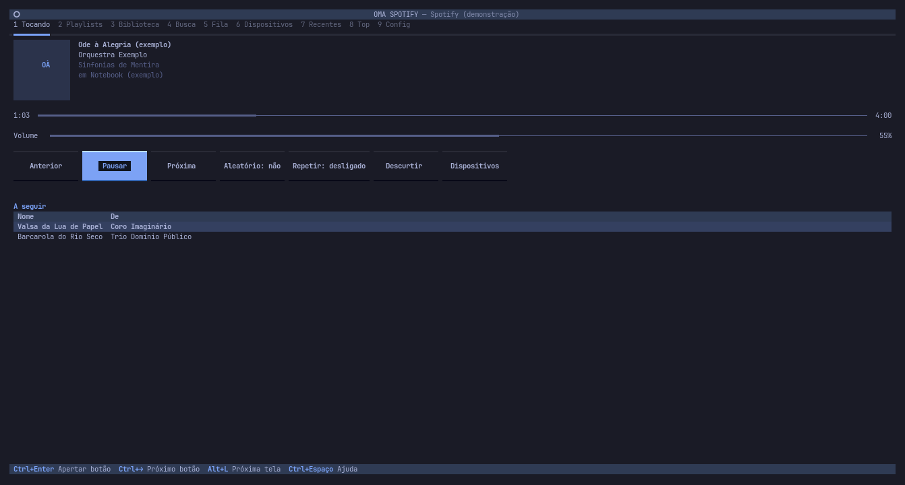
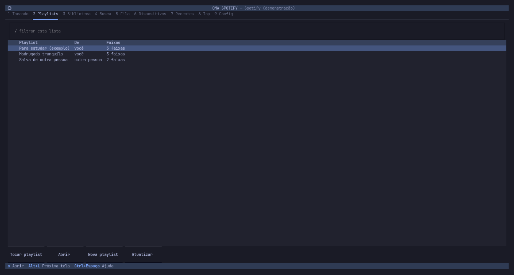
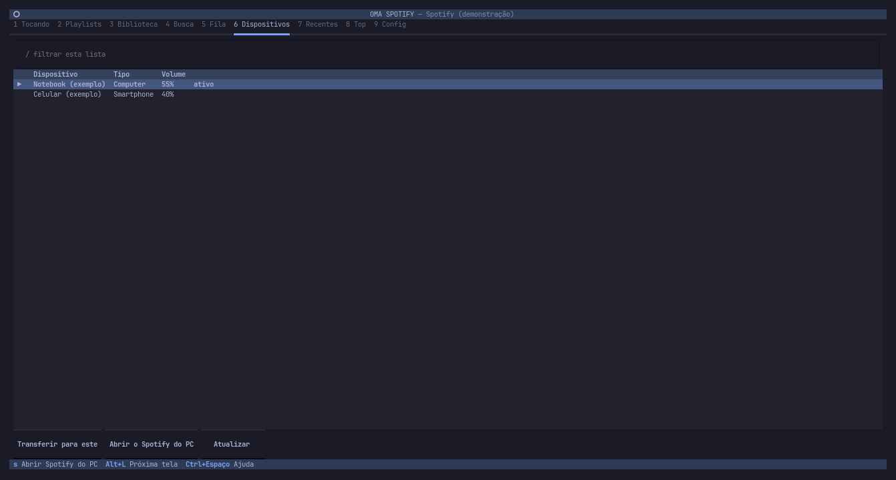

# oma-spotify

TUI em Python (Textual) para ouvir e organizar o Spotify pelo terminal, com mouse e teclado, em português do Brasil e nas cores do tema ativo do Omarchy. Fala com a Web API oficial e exige conta Premium.

Versão 0.1.0.

## Capturas de tela


Abertura: aparece na primeira vez de cada boot e passa com qualquer tecla, clique ou depois de 1,5 s.


Primeira execução, sem Client ID: passo a passo para criar o app no painel do Spotify, com um botão por passo.



Tocando agora: barra de progresso clicável (← → buscam quando ela está em foco), volume, aleatório, repetir, curtir e a fila "a seguir".



Playlists: Enter toca a lista inteira, `o` abre a lista para tocar uma faixa.


Busca: faixas, álbuns, artistas e playlists em abas. Tocar, pôr na fila, curtir ou guardar numa playlist.



Dispositivos: transferir a reprodução ou abrir o Spotify do PC. As capturas usam `--demo`, com dados fictícios.

## Recursos

- 9 telas: Tocando agora, Playlists, Biblioteca, Busca, Fila, Dispositivos, Recentes, Mais ouvidos e Configurações.
- Reprodução: play/pausa, próxima, anterior, buscar posição, volume, aleatório, repetir (desligado, contexto, faixa), tocar faixa, álbum, playlist ou artista, adicionar à fila, curtir e descurtir.
- Playlists: criar, adicionar faixa, remover faixa (com confirmação). Só nas playlists que são suas.
- Biblioteca: músicas curtidas, álbuns salvos, artistas seguidos e podcasts.
- Sem dispositivo ativo (o 404 do Spotify), o app explica em português e oferece "Abrir o Spotify do PC" (roda o comando `spotify` e espera ele aparecer) ou "Escolher dispositivo".
- Erros da API (sessão expirada, falta de Premium ou permissão, 429, 5xx, rede fora) em linguagem clara, sem stack trace. Em 429 o app espera o `Retry-After` e tenta de novo.
- "Tocando agora" atualiza a cada 2 s, só na aba visível, e interpola a barra entre as consultas.
- Tudo funciona por mouse e por teclado: toda tecla tem botão equivalente.
- Modo `--demo`: dados fictícios, sem login e sem rede.

## Criar o app no painel de desenvolvedor e entrar

O Spotify não deixa um app usar a API sem um app registrado por você. É uma vez só, uns 5 minutos. A tela de configuração guiada do `oma-spotify` mostra os mesmos passos, cada um com botão.

1. Abra <https://developer.spotify.com/dashboard> e entre com a sua conta.
2. Create app. Nome e descrição livres. Em Redirect URIs, adicione exatamente `http://127.0.0.1:8888/callback` (o app mostra o endereço certo, com a porta que você escolheu). Marque Web API.
3. Em Settings do app, copie o Client ID.
4. Em User Management, confira se o e-mail da sua conta está na lista (modo de desenvolvimento).
5. No `oma-spotify`, cole o Client ID e use "Entrar com o Spotify". O navegador abre, você autoriza e volta.

O login usa OAuth 2.0 com PKCE, sem client secret. Os tokens ficam em `$XDG_STATE_HOME/oma-spotify/tokens.json` (padrão `~/.local/state`), com permissão 0600, e são renovados sozinhos. O Client ID, a porta e a opção da abertura ficam em `$XDG_CONFIG_HOME/oma-spotify/config.json`.

## Instalar

Dependências: `python` (3.13 ou mais novo) e `python-textual`. Opcional: `spotify` (app de desktop) para o botão "Abrir o Spotify do PC".

```bash
cd packaging
./empacotar.sh              # gera o pacote em packaging/
sudo pacman -U oma-spotify-0.1.0-1-any.pkg.tar.zst
oma-spotify
```

Sem instalar: `uv run oma-spotify` na raiz do repositório (ou `uv run oma-spotify --demo`).

## Teclas, mouse e teclado

Cada tecla tem um botão ou item clicável equivalente. O rodapé mostra só as teclas da zona em foco; Ctrl+Espaço ou F1 abrem a lista completa da tela.

| Tecla | O que faz |
|---|---|
| Alt+← / Alt+→, Alt+h / Alt+l | tela anterior / próxima (funciona até dentro de campo de texto) |
| 1 a 9 | ir direto para a tela (fora de campo de texto) |
| ↑ ↓ / j k | linhas da lista |
| ← → / h l | entre botões e painéis da mesma tela (nunca trocam de tela) |
| Enter | tocar o item (playlist e álbum tocam inteiros) |
| Espaço | play/pausa, de qualquer tela, fora de campo de texto |
| `/` | filtrar a lista (na Busca, vai para o campo de busca) |
| `o` `a` `c` `p` | abrir, adicionar à fila, curtir, adicionar a playlist |
| `r` | remover da playlist aberta (pede confirmação) |
| `n` `b` `s` `r` `c` `+` `-` | Tocando agora: próxima, anterior, aleatório, repetir, curtir, volume |
| ← → na barra de progresso | buscar 5 s para trás ou para frente, só com a barra em foco |
| Ctrl+j / Ctrl+k | próxima / anterior seção |
| Ctrl+h / Ctrl+l | entre os botões |
| Ctrl+Enter | aperta o botão em foco |
| Esc | volta (da lista aberta, do campo para a lista) |
| Ctrl+Espaço, F1 | ajuda da tela |
| q | sair |

Com o mouse: clique nas abas, nas linhas (clicar numa linha já selecionada toca), nos botões e na barra de progresso e de volume.

## Abertura e contexto

Na primeira abertura de cada boot aparece OMA SPOTIFY em letras grandes (uma linha só em terminal pequeno). O marcador fica em `$XDG_RUNTIME_DIR/oma-spotify/`, que some ao desligar. A opção "Mostrar a abertura" fica nas Configurações e vem ligada.

O contexto da interface (aba, linha selecionada, filtro, texto da busca, categoria) é salvo em `$XDG_RUNTIME_DIR/oma-spotify/estado.json` e restaurado ao reabrir. Esse arquivo nunca recebe token, Client ID nem dados da conta.

## Desenvolvimento e testes

```bash
uv sync --extra dev
uv run pytest
uv run oma-spotify --demo
```

Os testes não usam rede nem conta real. A camada de API roda contra um servidor HTTP falso em 127.0.0.1 (`tests/fake_api.py`), e a interface roda com `pilot` (teclado e clique) contra um cliente falso (`services/falso.py`).

## Limites da API

Descobertas na documentação oficial (fevereiro de 2026 em diante) e o que isso muda aqui estão em [DECISOES.md](DECISOES.md). Em resumo: app em modo de desenvolvimento só funciona se o dono tiver Premium, aceita até 5 usuários cadastrados no painel, e a API não oferece mais recomendações, mais ouvidos por artista, lançamentos nem playlists editoriais. O app não mostra capa de álbum.

## Licença

MIT, ver [LICENSE](LICENSE).
