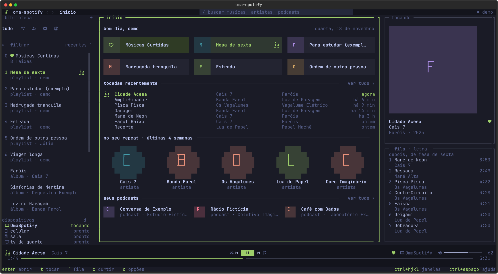
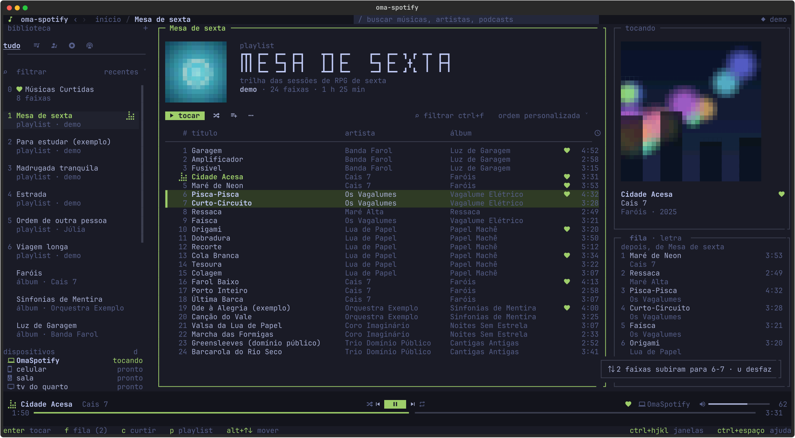
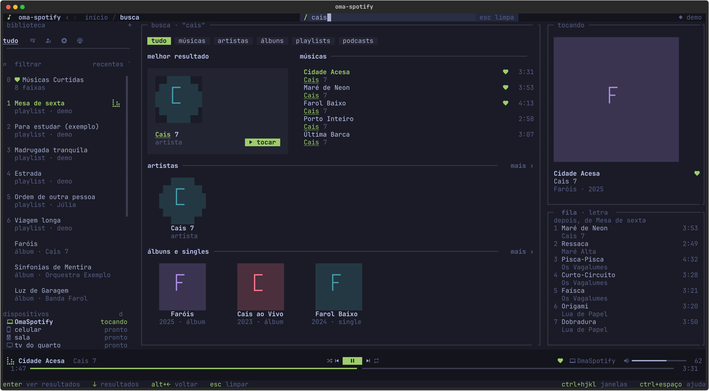
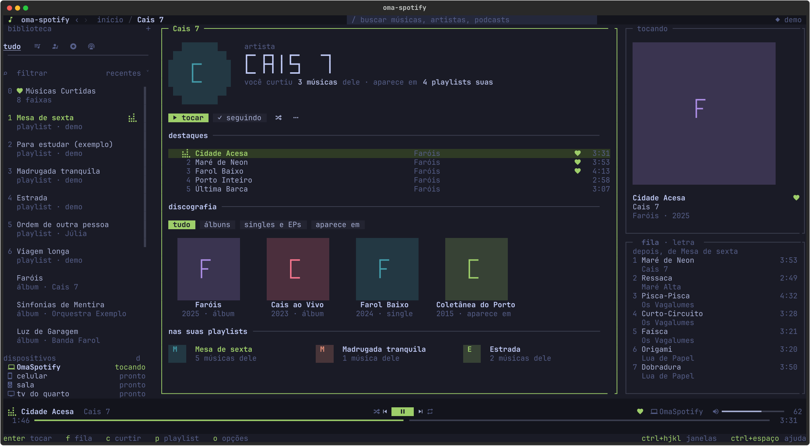
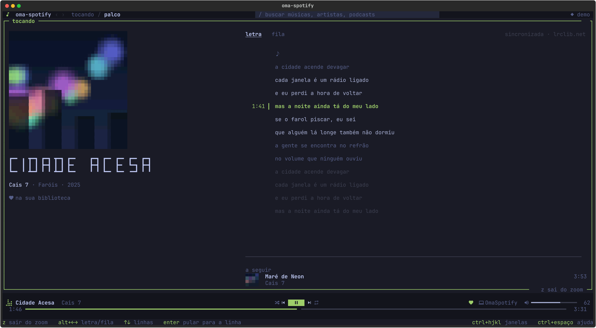
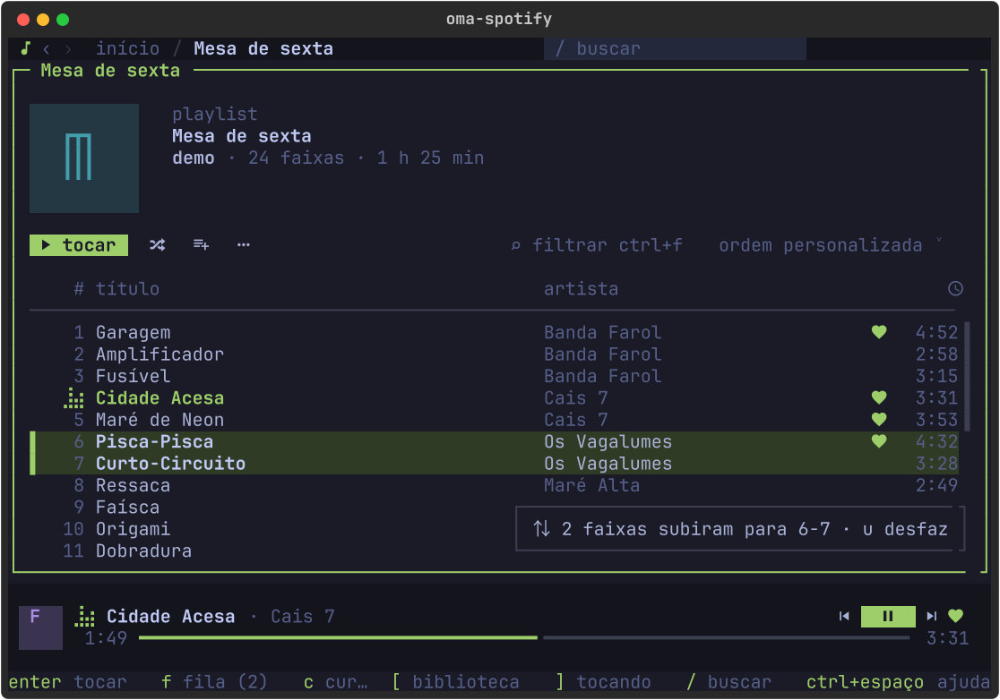
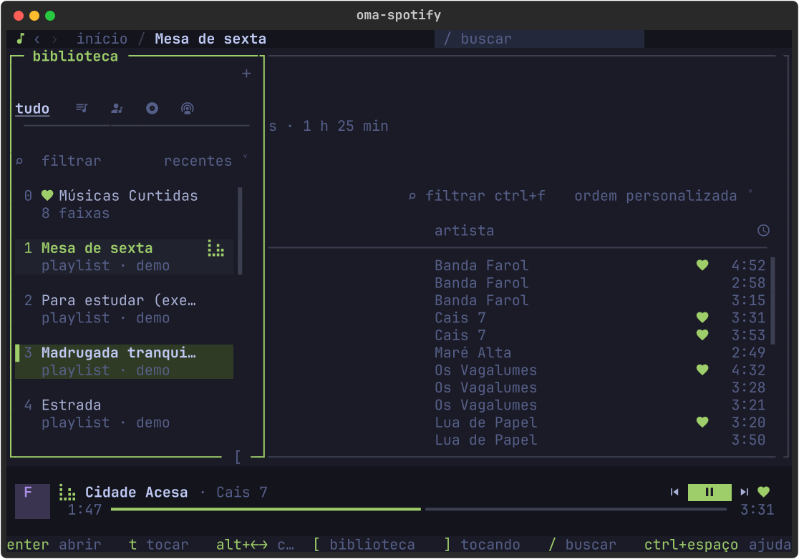

# oma-spotify

TUI em Python (Textual) para ouvir e organizar o Spotify pelo terminal, no modelo do [herdr](https://github.com/herdrdev/herdr): janelas com borda fina, só a janela em foco acende na cor de destaque, biblioteca numerada à esquerda e tudo por teclado e por mouse. Em português do Brasil e nas cores do tema ativo do Omarchy. Fala com a Web API oficial, exige conta Premium e toca pelo player local do plugin OmaSpotify, sem precisar do Spotify de desktop. A letra sincronizada vem da [LRCLIB](https://lrclib.net).

Versão 0.4.0.

## Capturas de tela

As capturas usam `--demo` (dados inventados) e foram geradas pelo próprio Textual em 180x48 (o Foot em tela cheia no notebook) e em 90x30 (meia tela). Nesta versão não há imagem de capa: onde o design tem capa ou foto, há um bloco na cor do item com a inicial (redondo para artistas).



Início. Topo com voltar, avançar, a trilha, a busca e a conta; biblioteca numerada (0 é Músicas Curtidas, 1 a 9 os fixados) com os aparelhos embaixo; Principal; Tocando; Fila · letra; player em faixa com a barra de progresso na largura toda.



Playlist sua: cabeçalho com título grande, tabela, duas faixas marcadas com Shift+↓ e movidas com Alt+↑ (o aviso oferece `u` para desfazer).



Busca ao vivo: os resultados aparecem enquanto você digita, com filtros e o trecho que casou sublinhado.



Artista: destaques (por busca `artist:"Nome"`), discografia com filtros e as suas playlists em que ele aparece.



Palco (`z` no Tocando ou na Fila): título grande, letra sincronizada e a próxima faixa.

 

Abaixo de 110 colunas fica só a Principal, sem a coluna de álbum, e o player encolhe. `[` abre a biblioteca como gaveta, `]` o Tocando.

Mais capturas em [docs/img](docs/img): `ir-para`, `opcoes`, `tocar-em`, `adicionar-playlist`, `teclas`, `login` e `abertura` nos dois tamanhos, `fila-letra` em 180x48 e `gaveta-tocando` em 90x30.

## O que tem

- **Topo** (sem borda): `‹` `›` voltam e avançam, a trilha de onde você está (clique num pedaço volta para ela), a busca com `/` e a conta (configurações, mais ouvidos, tocadas recentemente, verificar configuração, sair).
- **Biblioteca** (sem borda): categorias (tudo, playlists, artistas, álbuns, podcasts) com `Alt+←` `Alt+→`, filtro, ordem, itens numerados (`P` fixa e o item ganha um número de 1 a 9) e, embaixo, os aparelhos do Spotify Connect com o estado de cada um.
- **Principal**: Início (saudação, 6 atalhos, tocadas recentemente, no seu repeat, seus podcasts), Playlist e Músicas Curtidas (tabela com número, título, artista, álbum, curtida e duração; `Shift+↑` `Shift+↓` marcam, `Alt+↑` `Alt+↓` movem, `x` remove e `u` desfaz), Álbum, Podcast, Busca ao vivo (tudo, músicas, artistas, álbuns, playlists, podcasts; seções de 5 com “mais 5 ›”), Artista, tocadas recentemente, mais ouvidos e configurações.
- **Tocando**: capa, faixa, artista e álbum (clicáveis) e curtir.
- **Fila · letra**: a sua fila (do app, dá para mover e tirar) e o que vem depois no Spotify; na outra aba, a letra sincronizada. Clique no título troca a aba.
- **Player**: tocar ou pausar (o único botão cheio), anterior, próxima, aleatório, repetir, curtir, aparelho, mudo, volume e a barra de progresso (clique pula, roda e setas avançam 5 s, arrastar o `●` procura).
- **Diálogos**: ir para (`Ctrl+p`, procura na biblioteca, nas páginas e nos comandos), opções (`o` ou botão direito), tocar em (`d`, com volume por aparelho), adicionar à playlist (`p`, com “já tem”), teclas da janela (`Ctrl+Espaço` ou `F1`) e ajuda completa (`?`).
- **Avisos** no canto de baixo à direita; os que oferecem desfazer ficam 8 s.
- **Tamanhos**: 150 colunas ou mais mostram tudo; de 110 a 149 a direita vira gaveta (`]`); abaixo de 110 só a Principal, com gavetas dos dois lados; abaixo de 30 linhas o Tocando fica sem capa e o player numa linha.
- **Abertura** OMA SPOTIFY na primeira vez de cada boot e **primeiro acesso** guiado.
- Modo `--demo`: dados inventados, sem login e sem rede, cobrindo todas as telas.

## A sua fila

A fila do Spotify só pode ser lida e receber faixas; a API não deixa tirar nem reordenar. Por isso `f` põe a faixa numa fila do próprio app (“na sua fila”). O app entrega uma faixa por vez ao Spotify quando a atual está a 12 s do fim, ou na hora, se você pular com `.`. Até lá dá para mover (`Alt+↑` `Alt+↓`) e tirar (`x`, com `u` para desfazer). O que vem “depois” é do Spotify e só aparece. A sua fila fica guardada no contexto; com o app fechado, ela espera e o Spotify segue a playlist.

## Letra

A Web API do Spotify não tem letra. O app pede a letra à LRCLIB (`GET https://lrclib.net/api/get` com faixa, primeiro artista, álbum e duração), só quando a aba letra ou o palco estão abertos, e guarda as últimas 12 em memória. Só vai para a LRCLIB o que identifica a faixa. Sem letra, a aba diz “sem letra para esta faixa” e, no palco, a fila ocupa o lugar. A busca da letra pode ser desligada nas Configurações.

## Tocar pelo plugin OmaSpotify

O plugin Omarchy [OmaSpotify](https://github.com/jeremylanger/omaspotify) (outro autor, licença MIT) traz um motor de reprodução local que aparece para o Spotify como um dispositivo Connect chamado "OmaSpotify", rodando como serviço de usuário `omaspotify.service`. O oma-spotify usa esse dispositivo pela Web API, sem ler nada do plugin e sem copiar código dele:

1. Procura o dispositivo "OmaSpotify" em `/me/player/devices`. Se já existe, transfere a reprodução e toca.
2. Se não existe e o plugin está instalado (unidade `omaspotify.service` do usuário e o binário do plugin), roda `systemctl --user start omaspotify.service`, espera o dispositivo aparecer (até 30 s), transfere e toca.
3. Se o plugin não está instalado ou o serviço não inicia, mostra uma mensagem curta no player dizendo o que fazer. Se o serviço inicia mas o dispositivo não aparece, a causa mais comum é a autorização de reprodução incompleta: abra o OmaSpotify e conclua "Finish playback setup".
4. O oma-spotify nunca instala nada nem mexe nos arquivos, credenciais ou chaveiro do plugin.

Em Configurações, "tocar por" escolhe o alvo: automático (plugin OmaSpotify se instalado, senão Spotify do PC), plugin OmaSpotify, Spotify do PC (`/usr/bin/spotify`) ou "escolher o aparelho" (abre o diálogo tocar em). O diálogo tocar em (`d`) também oferece iniciar o OmaSpotify e abrir o Spotify do PC quando eles não estão na lista.

## Criar o app no painel de desenvolvedor e entrar

O Spotify não deixa um app usar a API sem um app registrado por você. É uma vez só, uns 2 minutos. A tela de primeiro acesso mostra os mesmos passos.

1. Abra <https://developer.spotify.com/dashboard> e entre com a sua conta. Create app, nome e descrição livres, marque Web API.
2. Em Redirect URIs, adicione exatamente `http://127.0.0.1:8888/callback` (o app mostra o endereço certo, com a porta que você escolheu; `localhost` não é aceito).
3. Em Settings do app, copie o Client ID. Em User Management, confira se o e-mail da sua conta está na lista (modo de desenvolvimento).
4. No `oma-spotify`, cole o Client ID (32 caracteres, números e letras de a a f) e use "entrar pelo navegador". O navegador abre, você autoriza e volta.

Enquanto espera, a tela mostra a contagem regressiva e os botões "copiar link de login", "abrir o navegador de novo", "copiar o redirect URI", "cancelar a espera" (fecha a porta na hora) e "deu erro na página do Spotify?". "verificar configuração" (também nas Configurações) mostra o início e o fim do Client ID, o Redirect URI enviado, se a porta está livre e se há conexão com accounts.spotify.com, sem chamada autenticada. Teclas na espera: `c` copiar link, `a` abrir de novo, `u` copiar Redirect URI, `x` ou Esc cancelar, `e` erros comuns, `v` verificar.

### Erros comuns no login

| O que aparece | Causa e solução |
|---|---|
| `redirect_uri: Not matching configuration` ou INVALID_CLIENT | O Redirect URI do painel não é igual ao que o app envia. No painel do app: Edit settings, remova o URI antigo, cole o valor do botão "copiar", Add, clique em SAVE no fim da página e espere um minuto. |
| `User not registered in the Developer Dashboard` ou 403 | Adicione o e-mail da sua conta Spotify em User Management do app. |
| Página em branco ou "não foi possível conectar" em 127.0.0.1 | A porta está ocupada ou o app foi fechado durante a espera. Use "verificar configuração" e tente de novo, ou troque a porta nas Configurações (e atualize o painel). |
| App diz que o Client ID é inválido | Precisa ter exatamente 32 caracteres hexadecimais, sem espaço. Copie de novo em Settings do app. |
| `invalid_client`, `invalid_grant`, `invalid_request` depois de autorizar | O app mostra a causa de cada um: Client ID não reconhecido, código expirado ou já usado, ou Redirect URI divergente. |

O login usa OAuth 2.0 com PKCE, sem client secret. Os tokens ficam em `$XDG_STATE_HOME/oma-spotify/tokens.json` (padrão `~/.local/state`), com permissão 0600, e são renovados sozinhos. O Client ID, a porta, os itens fixados e as opções ficam em `$XDG_CONFIG_HOME/oma-spotify/config.json`.

## Instalar

Dependências: `python` (3.13 ou mais novo) e `python-textual`. Opcionais: o plugin OmaSpotify (player local, usado por padrão) e `spotify` (app de desktop, segunda opção). Os ícones usam Nerd Font (o Omarchy já vem com ela); `"icones": "simples"` no config.json, ou o botão nas Configurações, troca por caracteres comuns.

```bash
cd packaging
./empacotar.sh              # gera o pacote em packaging/
sudo pacman -U oma-spotify-0.4.0-1-any.pkg.tar.zst
oma-spotify
```

Sem instalar: `uv run oma-spotify` na raiz do repositório (ou `uv run oma-spotify --demo`). O `--demo` usa uma configuração temporária e um contexto separado, então não mexe nos seus.

## Teclas, mouse e teclado

Três camadas, como no nvim e no herdr:

| Camada | Teclas | O que faz |
|---|---|---|
| `Ctrl` + direção | `Ctrl+←` `↑` `↓` `→` ou `Ctrl+h` `j` `k` `l` | troca de janela, pela posição na tela |
| direção | `←` `↑` `↓` `→` ou `h` `j` `k` `l` | anda dentro da janela |
| `Alt` + `←` `→` | `Alt+←` `Alt+→` ou `Alt+h` `Alt+l` | troca a aba (Biblioteca, Fila · letra) ou a página (Principal, como voltar e avançar) |
| `Alt` + `↑` `↓` | `Alt+↑` `Alt+↓` ou `Alt+k` `Alt+j` | move o item selecionado (playlist sua, sua fila) |

`Tab` e `Shift+Tab` passam pelas janelas nesta ordem: topo, biblioteca, principal, tocando, fila, player. Do player, `Ctrl+↑` volta para a última janela de cima que teve foco; do topo, `Ctrl+↓` também.

Em qualquer janela (fora de campo de texto): `Espaço` tocar ou pausar, `,` `.` anterior e próxima, `Shift+←` `Shift+→` 5 s, `-` `+` volume, `m` mudo, `s` aleatório, `r` repetir, `c` curtir, `/` buscar, `Ctrl+p` ir para, `0` Músicas Curtidas, `1` a `9` os fixados, `d` tocar em, `z` zoom (palco no Tocando e na Fila), `[` `]` esconder ou mostrar as laterais, `Ctrl+Espaço` ou `F1` teclas da janela, `?` ajuda completa, `F5` recarregar, `Esc` fecha diálogo, gaveta ou zoom e limpa a seleção e a busca, `q` sai (a música continua).

Num item: `Enter` abre ou toca, `t` toca sem abrir, `f` tocar a seguir, `p` adicionar à playlist, `a` ir para o artista, `y` copiar o link, `o` opções, `P` fixar, `x` remover (da biblioteca pede confirmação), `u` desfaz, `Ctrl+f` filtra, `g` `G` (ou `Home` `End`) topo e fim.

Com o mouse: clique foca a janela e seleciona; clique de novo na mesma linha, ou duplo clique, abre ou toca. Botão direito abre as opções. A roda rola; em cima da barra de progresso volta e avança 5 s; em cima do volume muda de 5 em 5. Com o mouse em cima de uma faixa, o número vira `▶` (clique toca) e aparece o coração vazio (clique curte). Arrastar a divisa entre janelas muda a largura da Biblioteca e do Tocando. Duplo clique no título de uma janela dá zoom. O rodapé mostra as teclas da janela em foco e cada uma é clicável.

Em alguns terminais `Ctrl+j` chega como Enter e `Ctrl+h` como Backspace: use `Ctrl` com as setas. Dentro do herdr, `Ctrl+Espaço` é o prefixo dele: use `F1`.

## Memória

O app foi medido com `--demo` num pseudo-terminal de 180x48 (Python 3.13, Textual 8.2), lendo o `VmRSS` do processo:

| Versão | Em repouso | Depois de usar |
|---|---|---|
| 0.3.0 | 48 a 51 MB | 95 MB (25 rodadas de abrir, voltar e buscar) |
| 0.4.0 | 50 MB | 68 MB (80 páginas e 20 buscas), 69 MB (160 páginas e 40 buscas) |

Na 0.4.0 o uso para de crescer depois das primeiras páginas. O que segura a memória: listas virtualizadas (só desenham as linhas visíveis), uma página por vez na Principal, histórico de 30 páginas, cache de letras com 12 faixas e de playlists com 24, imports preguiçosos (login, diálogos, palco, cliente da API, LRCLIB), um pool de 4 threads no lugar de uma thread por chamada, equalizador só enquanto a faixa toca e o terminal está em foco, e consulta ao player a cada 2 s em foco e a cada 10 s em segundo plano. O teste `tests/integration/test_memoria.py` falha se o repouso passar de 75 MB, o uso passar de 100 MB ou a navegação deixar widgets ou mais de 25 MB para trás.

## Abertura e contexto

Na primeira abertura de cada boot aparece OMA SPOTIFY em letras grandes (uma linha só em terminal pequeno). O marcador fica em `$XDG_RUNTIME_DIR/oma-spotify/`, que some ao desligar. A opção "mostrar a abertura" fica nas Configurações e vem ligada.

O contexto da interface (histórico de páginas, linha selecionada, categoria, filtro e ordem da biblioteca, larguras, laterais escondidas, aba da Fila, a sua fila e o texto da busca) é salvo em `$XDG_RUNTIME_DIR/oma-spotify/estado.json` e restaurado ao reabrir. Esse arquivo nunca recebe token, Client ID nem dados da conta.

## Desenvolvimento e testes

```bash
uv sync --extra dev
uv run pytest
uv run oma-spotify --demo
```

Os testes não usam rede nem conta real. A camada de API roda contra um servidor HTTP falso em 127.0.0.1 (`tests/fake_api.py`), a LRCLIB contra respostas falsas, a interface roda com `pilot` (teclado e clique) contra um cliente falso (`services/falso.py`) e o plugin OmaSpotify é simulado por um serviço falso (`tests/conftest.py`).

## Limites da API

O app roda como app pessoal (o Development Mode do Spotify), cada pessoa com o próprio Client ID. Isso moldou a interface (detalhes em [DECISOES.md](DECISOES.md)):

| Limite | Como o app lida |
|---|---|
| O dono do app precisa de Premium, e o app aceita até 5 usuários | cada pessoa cria o próprio app no primeiro acesso |
| As faixas só vêm de playlists suas ou colaborativas | playlist de outra pessoa mostra só o cabeçalho, para tocar e seguir |
| A busca entrega no máximo 10 por página | seções de 5, com “mais 5 ›” |
| Saíram as mais tocadas do artista, as novidades e as categorias | destaques vêm de uma busca `artist:"Nome"`, e não há tela de explorar |
| Saíram seguidores e popularidade | a página do artista não mostra ouvintes |
| A fila do Spotify só pode ser lida e receber faixas | “na sua fila” é uma fila do app (ver acima) |
| A Web API não tem letra | a letra vem da LRCLIB |

## Licença

MIT, ver [LICENSE](LICENSE).
