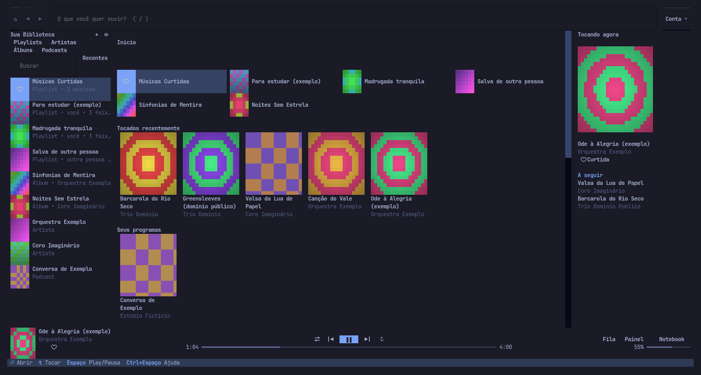
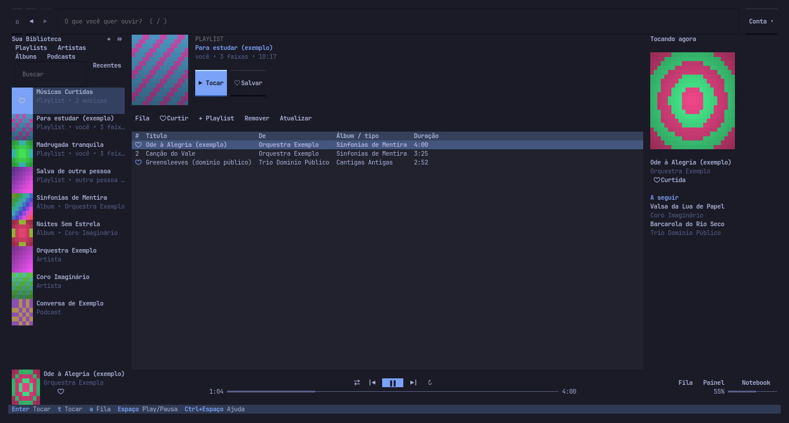
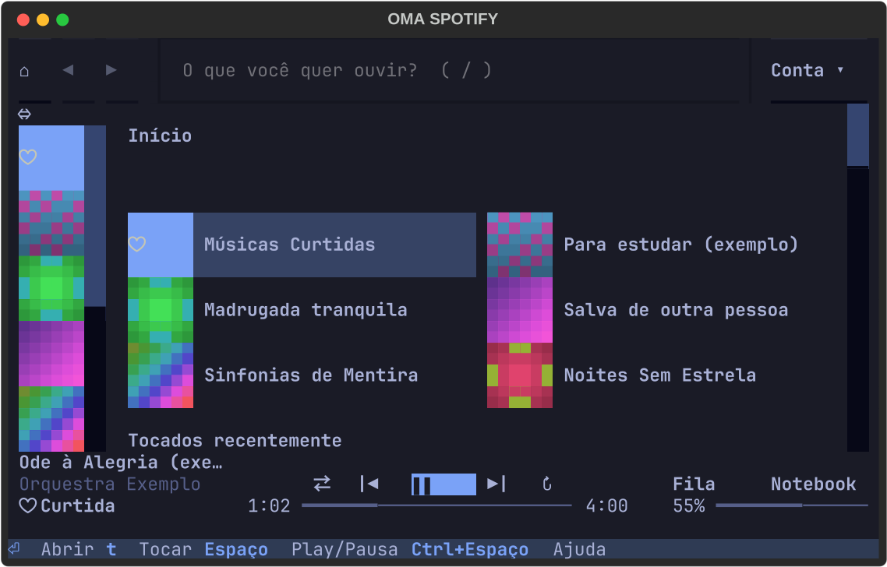
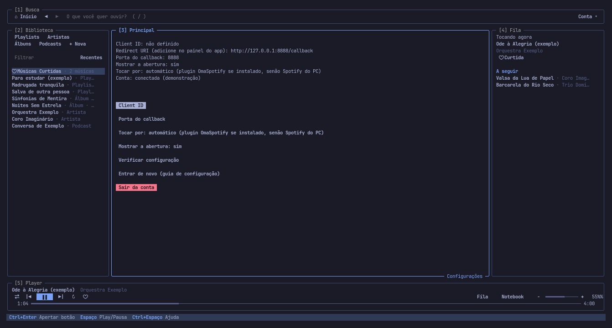

# oma-spotify

TUI em Python (Textual) para ouvir e organizar o Spotify pelo terminal, feita de janelas com borda e título numerado no estilo do lazydocker e do tmux, com mouse e teclado, em português do Brasil e nas cores do tema ativo do Omarchy. Fala com a Web API oficial e exige conta Premium. Toca pelo player local do plugin OmaSpotify, sem precisar do Spotify de desktop.

Versão 0.3.0.

## Capturas de tela


Abertura: aparece na primeira vez de cada boot e passa com qualquer tecla, clique ou depois de 1,5 s.



Início: as cinco janelas, [1] Busca, [2] Biblioteca, [3] Principal, [4] Fila e [5] Player. A janela com foco tem a borda e o título na cor de destaque.



Página de playlist: botão tocar, salvar e a lista de faixas com colunas.


Busca: digitada na janela [1], com chips Tudo, Músicas, Álbuns, Artistas, Playlists e Podcasts.


Dispositivos: transferir a reprodução, iniciar o player do OmaSpotify ou abrir o Spotify do PC.



Terminal de 80x24: a janela [4] Fila some e a biblioteca estreita (renderizado pelo próprio Textual, por isso a moldura da janela).



Configurações: Client ID, porta, "Tocar por", abertura, verificar configuração e sair da conta. As capturas usam `--demo`, com dados fictícios.

## Recursos

- **Cinco janelas**, cada uma com borda e título: [1] Busca (início, voltar e avançar do histórico, campo de busca, menu da conta), [2] Biblioteca (chips Playlists, Artistas, Álbuns e Podcasts, filtro, ordenação, Músicas Curtidas no topo), [3] Principal (Início, playlist, álbum, artista, busca, curtidas, fila, recentes, mais ouvidos, dispositivos e configurações), [4] Fila (o que toca e o que vem a seguir, opcional) e [5] Player (barra de progresso, controles e volume). Tudo em listas de texto.
- **Responsivo:** a janela [4] some abaixo de 120 colunas e a biblioteca estreita abaixo de 100. Funciona em 80x24 e fica confortável em 170x45.
- **Reprodução:** play/pausa, próxima, anterior, buscar posição, volume, aleatório, repetir (desligado, lista, faixa), tocar faixa, álbum, playlist ou artista, fila e curtir.
- **Playlists:** criar, adicionar faixa, remover faixa (com confirmação), só nas suas.
- **Toca sozinho pelo player certo:** sem dispositivo ativo, o app não mostra diálogo. Ele acha ou inicia o player do plugin OmaSpotify (ver abaixo), transfere a reprodução e repete o que você pediu. O andamento aparece na janela [5] ("Iniciando o player do OmaSpotify...").
- Erros da API em linguagem clara, sem stack trace. Em 429 o app espera o `Retry-After` e tenta de novo.
- Tudo funciona por mouse e por teclado: toda tecla tem botão equivalente, a roda do mouse rola as listas.
- Modo `--demo`: dados fictícios, sem login e sem rede.

## Tocar pelo plugin OmaSpotify

O plugin Omarchy [OmaSpotify](https://github.com/jeremylanger/omaspotify) (outro autor, licença MIT) traz um motor de reprodução local que aparece para o Spotify como um dispositivo Connect chamado "OmaSpotify", rodando como serviço de usuário `omaspotify.service`. O oma-spotify usa esse dispositivo pela Web API, sem ler nada do plugin e sem copiar código dele:

1. Procura o dispositivo "OmaSpotify" em `/me/player/devices`. Se já existe, transfere a reprodução e toca.
2. Se não existe e o plugin está instalado (unidade `omaspotify.service` do usuário e o binário do plugin), roda `systemctl --user start omaspotify.service`, espera o dispositivo aparecer (até 30 s), transfere e toca.
3. Se o plugin não está instalado ou o serviço não inicia, mostra uma mensagem curta na janela [5] dizendo o que fazer. Se o serviço inicia mas o dispositivo não aparece, a causa mais comum é a autorização de reprodução incompleta: abra o OmaSpotify e conclua "Finish playback setup".
4. O oma-spotify nunca instala nada nem mexe nos arquivos, credenciais ou chaveiro do plugin.

Em Configurações, "Tocar por" escolhe o alvo: automático (plugin OmaSpotify se instalado, senão Spotify do PC), plugin OmaSpotify, Spotify do PC (`/usr/bin/spotify`) ou "escolher o dispositivo" (abre a página Dispositivos). A página Dispositivos também tem os botões "Iniciar o OmaSpotify" e "Abrir o Spotify do PC".

## Criar o app no painel de desenvolvedor e entrar

O Spotify não deixa um app usar a API sem um app registrado por você. É uma vez só, uns 5 minutos. A tela de configuração guiada do `oma-spotify` mostra os mesmos passos, cada um com botão.

1. Abra <https://developer.spotify.com/dashboard> e entre com a sua conta.
2. Create app. Nome e descrição livres. Em Redirect URIs, adicione exatamente `http://127.0.0.1:8888/callback` (o app mostra o endereço certo, com a porta que você escolheu). Marque Web API.
3. Em Settings do app, copie o Client ID.
4. Em User Management, confira se o e-mail da sua conta está na lista (modo de desenvolvimento).
5. No `oma-spotify`, cole o Client ID (32 caracteres, números e letras de a a f) e use "Entrar com o Spotify". O navegador abre, você autoriza e volta.

Enquanto espera, a tela mostra a contagem regressiva e os botões "Copiar link de login", "Abrir o navegador de novo", "Copiar o Redirect URI", "Cancelar a espera" (fecha a porta na hora) e "Deu erro na página do Spotify?". "Verificar configuração" (também nas Configurações) mostra o início e o fim do Client ID, o Redirect URI enviado, se a porta está livre e se há conexão com accounts.spotify.com, sem chamada autenticada. Teclas na tela de espera: `c` copiar link, `a` abrir de novo, `u` copiar Redirect URI, `x` ou Esc cancelar, `e` erros comuns, `v` verificar.

### Erros comuns no login

| O que aparece | Causa e solução |
|---|---|
| `redirect_uri: Not matching configuration` ou INVALID_CLIENT | O Redirect URI do painel não é igual ao que o app envia. No painel do app: Edit settings, remova o URI antigo, cole o valor do botão "Copiar o Redirect URI", Add, clique em SAVE no fim da página e espere um minuto. |
| `User not registered in the Developer Dashboard` ou 403 | Adicione o e-mail da sua conta Spotify em User Management do app. |
| Página em branco ou "não foi possível conectar" em 127.0.0.1 | A porta está ocupada ou o app foi fechado durante a espera. Use "Verificar configuração" e tente de novo, ou troque a porta nas Configurações (e atualize o painel). |
| App diz que o Client ID é inválido | Precisa ter exatamente 32 caracteres hexadecimais, sem espaço. Copie de novo em Settings do app. |
| `invalid_client`, `invalid_grant`, `invalid_request` depois de autorizar | O app mostra a causa de cada um: Client ID não reconhecido, código expirado ou já usado, ou Redirect URI divergente. |

O login usa OAuth 2.0 com PKCE, sem client secret. Os tokens ficam em `$XDG_STATE_HOME/oma-spotify/tokens.json` (padrão `~/.local/state`), com permissão 0600, e são renovados sozinhos. O Client ID, a porta e a opção da abertura ficam em `$XDG_CONFIG_HOME/oma-spotify/config.json`.

## Instalar

Dependências: `python` (3.13 ou mais novo) e `python-textual`. Opcionais: o plugin OmaSpotify (player local, usado por padrão) e `spotify` (app de desktop, segunda opção).

```bash
cd packaging
./empacotar.sh              # gera o pacote em packaging/
sudo pacman -U oma-spotify-0.3.0-1-any.pkg.tar.zst
oma-spotify
```

Sem instalar: `uv run oma-spotify` na raiz do repositório (ou `uv run oma-spotify --demo`).

## Teclas, mouse e teclado

Cada tecla tem um botão ou item clicável equivalente. O rodapé mostra só as teclas da janela em foco; Ctrl+Espaço ou F1 abrem a lista completa.

| Tecla | O que faz |
|---|---|
| Ctrl+← ↑ ↓ → (ou Ctrl+h j k l, ou Alt+setas) | foco para a janela mais próxima na direção |
| 1 a 5 | pula para a janela [1] Busca, [2] Biblioteca, [3] Principal, [4] Fila, [5] Player (fora de campo de texto) |
| ↑ ↓ / j k | linhas |
| ← → / h l | botões e colunas da mesma fileira (no player, andam entre os botões) |
| Enter | abrir o item; faixas tocam; no player aperta o botão |
| t | tocar o item selecionado (playlist, álbum e artista tocam inteiros) |
| `/` | ir para a busca da janela [1] (Enter busca, Esc volta) |
| Esc, Backspace, Alt+[ | voltar no histórico; Alt+] avança |
| Espaço | play/pausa, fora de campo de texto |
| n  p | próxima, anterior |
| s  r | aleatório, repetir (desligado, lista, faixa) |
| + - | volume |
| c | curtir a faixa tocando; numa lista, curtir o item selecionado |
| ← → na barra de progresso | buscar 5 s, só com a barra em foco |
| a  m  d | numa lista: adicionar à fila, adicionar a uma playlist, remover da playlist (com confirmação) |
| f  i  d | fora das listas: fila, início, dispositivos |
| Ctrl+P  Ctrl+B | mostrar ou esconder as janelas [4] Fila e [2] Biblioteca |
| Ctrl+N | nova playlist (na biblioteca) |
| Ctrl+Enter | aperta o botão em foco |
| Ctrl+Espaço, F1 | ajuda da janela |
| q | sair |

Com o mouse: clique foca a janela e aperta botões, abre linhas e muda a posição ou o volume nas barras; a roda rola as listas. O botão Conta abre Dispositivos, Fila, Tocados recentemente, Mais ouvidos, Configurações, Verificar configuração e Sair da conta.

## Abertura e contexto

Na primeira abertura de cada boot aparece OMA SPOTIFY em letras grandes (uma linha só em terminal pequeno). O marcador fica em `$XDG_RUNTIME_DIR/oma-spotify/`, que some ao desligar. A opção "Mostrar a abertura" fica nas Configurações e vem ligada.

O contexto da interface (página aberta na janela [3] e o histórico, linha selecionada, janela [4] aberta, biblioteca escondida, filtro e chip da biblioteca, texto da busca) é salvo em `$XDG_RUNTIME_DIR/oma-spotify/estado.json` e restaurado ao reabrir. Esse arquivo nunca recebe token, Client ID nem dados da conta.

## Desenvolvimento e testes

```bash
uv sync --extra dev
uv run pytest
uv run oma-spotify --demo
```

Os testes não usam rede nem conta real. A camada de API roda contra um servidor HTTP falso em 127.0.0.1 (`tests/fake_api.py`), e a interface roda com `pilot` (teclado e clique) contra um cliente falso (`services/falso.py`), e o plugin OmaSpotify é simulado por um serviço falso (`tests/conftest.py`).

## Limites da API

Descobertas na documentação oficial (fevereiro de 2026 em diante) e o que isso muda aqui estão em [DECISOES.md](DECISOES.md). Em resumo: app em modo de desenvolvimento só funciona se o dono tiver Premium, aceita até 5 usuários cadastrados no painel, e a API não oferece mais recomendações, mais ouvidos por artista, lançamentos nem playlists editoriais. O Início usa só o que a API entrega (recentes, biblioteca, programas, artistas e mais ouvidos): não há feed Home, lançamentos nem recomendações. Não há letra de música nem capa de álbum.

## Licença

MIT, ver [LICENSE](LICENSE).
